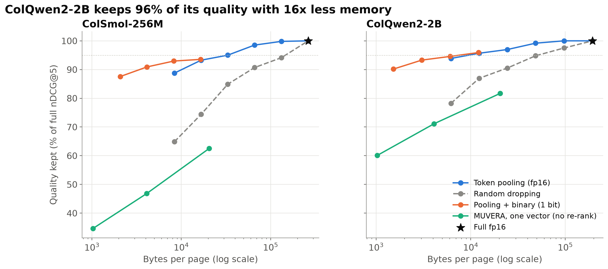
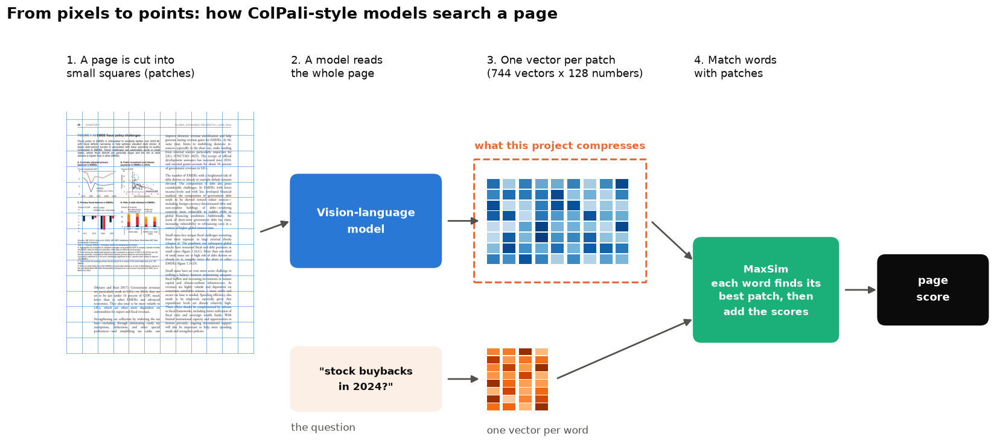
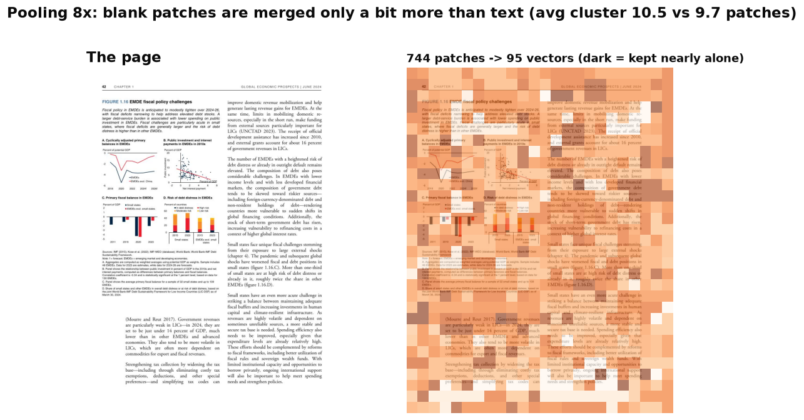
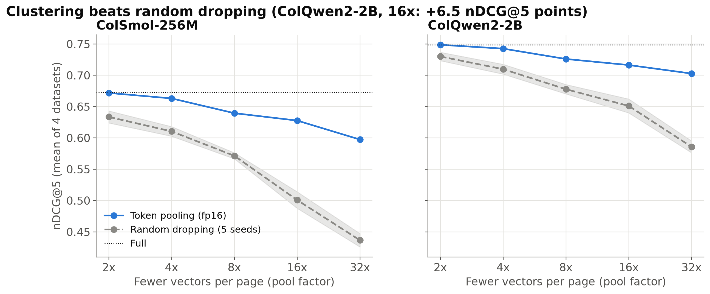
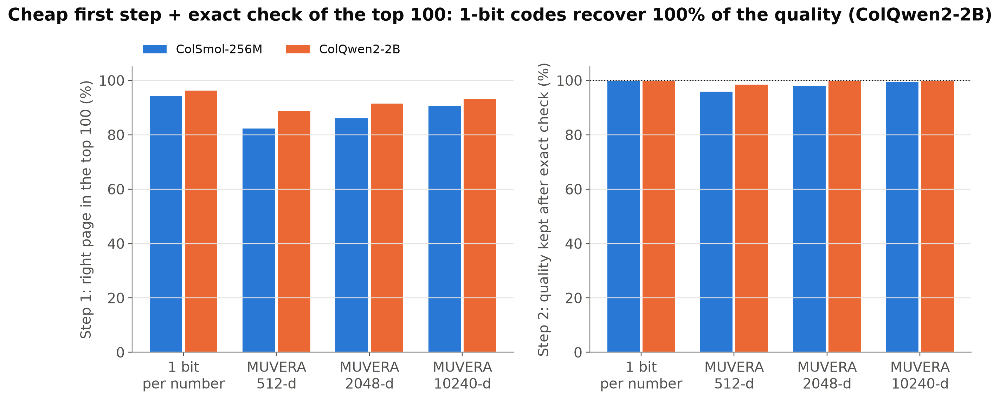
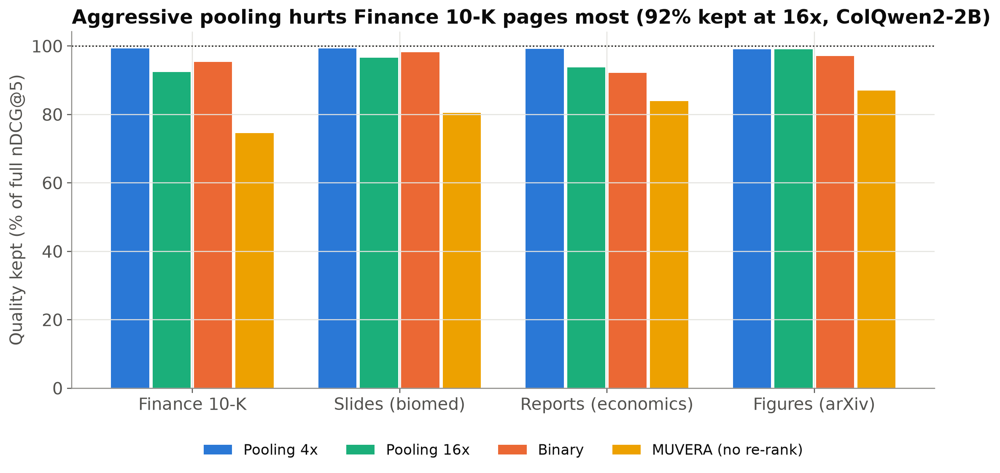
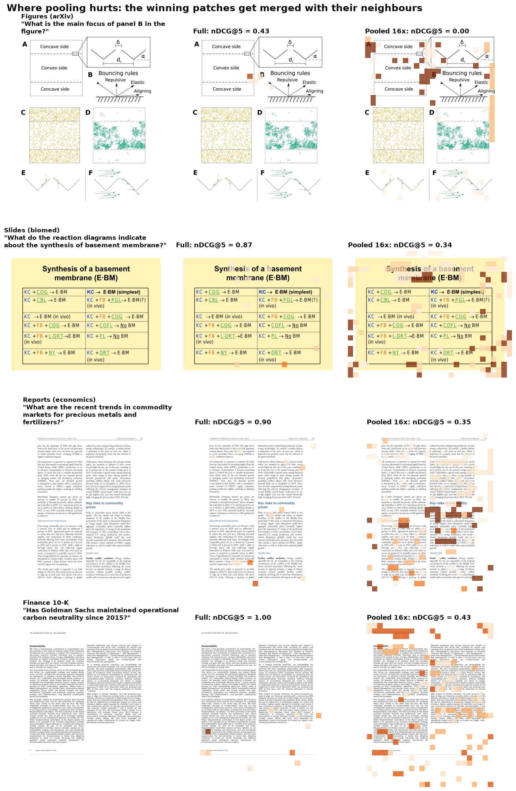

<h1 align="center">From Pixels to Points</h1>
<p align="center"><b>Compressing Visual Document Search</b></p>
<p align="center"><i>Some AI models search documents by looking at the pages, like we do.<br>They need hundreds of vectors per page. How many does a page really need?</i></p>



## Built on

| Paper | In one line |
|---|---|
| **[ColPali](https://arxiv.org/abs/2407.01449)**| Searches page *images* with one vector per patch. The models compressed here. |
| **[Token Pooling](https://arxiv.org/abs/2409.14683)** | Merges similar vectors of a page. The main compression method. |
| **[MUVERA](https://arxiv.org/abs/2405.19504)**| Turns many vectors into one. Used as a fast first step. |

## TL;DR

- **Merging similar vectors is almost free.** 4× fewer vectors keeps 99% of the quality. 16× fewer keeps 96%. Dropping vectors at random keeps only 87%.
- **One bit per number is enough to find the right pages.** With 4× merging plus 1 bit, a million pages go from **194 GB to 3 GB** and keep **93%** of the quality.
- **A single vector per page is not enough on its own** (60 to 82%). As a first filter, followed by an exact check of the top 100, it keeps 98.5 to 100%.

## The problem

A company has millions of PDF pages. Someone asks: *"How much did we spend on stock buybacks in 2024?"*
The answer is one number, in one table, on one page.

The old way is to turn the pages into text (OCR) and search the text. It often breaks on tables,
charts and scans. Models like ColPali skip that step: they look at the page image directly.



The catch: a page becomes **hundreds of vectors**, not one. With ColQwen2, that is 757 vectors of
128 numbers per page, so **1 million pages take 194 GB** of fast memory. The smaller model, ColSmol,
is even worse (264 GB), because it cuts pages into more pieces.

So the question is simple: **how few vectors, and how few bits, does a page really need?**

## Four ways to make it smaller

**Token pooling** ([Clavié et al.](https://arxiv.org/abs/2409.14683)). Group similar vectors and keep
their average. To check that the grouping matters, it is compared with a dumb baseline: throw away
the same number of vectors at random.



**Binarization.** Keep only the sign of each number: 1 bit instead of 16. Each vector becomes 16×
smaller.

**MUVERA** ([Dhulipala et al.](https://arxiv.org/abs/2405.19504)). Build one long vector per page that
behaves almost like the full set. Any normal vector database can search it. Then the best 100 pages
are checked again with the full vectors.

**Mix them.** Fewer vectors and fewer bits per vector work together.

## Results

Two models (ColQwen2-2B and ColSmol-256M), four kinds of pages (finance reports, slides, economic
reports, science figures) from the [ViDoRe benchmark](https://arxiv.org/abs/2601.08620). "Quality
kept" compares the ranking score (nDCG@5) with the uncompressed version.

| Method | 1M pages (ColQwen2) | Quality kept, ColQwen2 | Quality kept, ColSmol |
|---|---:|---:|---:|
| Full | 194 GB | 100% | 100% |
| Pooling 4× | 49 GB | **99.2%** | 98.5% |
| Pooling 16× | 12 GB | **95.7%** | 93.3% |
| Random dropping 16× | 12 GB | 86.9% | 74.4% |
| 1 bit per number | 12 GB | 95.9% | 93.5% |
| Pooling 4× + 1 bit | **3 GB** | **93.3%** | 90.9% |
| MUVERA, one vector | 1 to 20 GB | 60 to 82% | 35 to 63% |
| MUVERA, then exact check of top 100 | | 98.5 to 100% | 95.8 to 99.4% |

Every number comes from [`results/`](results/). The full table is in [`results/table.md`](results/table.md).



Two things stand out. Smart merging beats random dropping by a wide margin, so *which* vectors get
merged really matters. And the bigger model handles compression better at every setting.



## Where it hurts

The type of page that suffers most depends on the model. ColQwen2 loses most on dense finance pages
(92% kept at 16×). ColSmol loses most on slides (88%). Science figures are the safest for both.



Below, each query word picks its best patch, and that patch lights up. With the full vectors, a few
exact spots win. After heavy merging, a "winner" is the average of a whole group of patches, so the
signal gets spread out and the wrong pages start to win.



## Surprises

- **A tiny bug cost 5 points.** When you average vectors, you must rescale the result back to length 1.
  My first version skipped this, and quality dropped from 0.514 to 0.464.
- **White space is not merged first.** Blank patches end up in groups almost as small as text patches
  (10.5 vs 9.7 patches). The model mixes information from the whole page into every patch.
- **1 bit is smaller, but not faster here.** In plain NumPy, bit tricks were slower than normal math
  (178 ms vs 7 ms per query). Real speed needs special low-level code.
- **The small model needs the biggest index.** ColSmol makes 1,030 vectors per page, ColQwen2 only 757.

## How it was tested

- Models: [ColQwen2](https://huggingface.co/vidore/colqwen2-v1.0) and [ColSmol](https://huggingface.co/vidore/colSmol-256M). Pages encoded once on a laptop GPU (Apple M4), everything else on CPU.
- Data: 1,402 pages and 339 English questions from [finance](https://huggingface.co/datasets/vidore/vidore_v3_finance_en), [slides](https://huggingface.co/datasets/vidore/biomedical_lectures_v2), [economics](https://huggingface.co/datasets/vidore/economics_reports_v2) and [arXiv](https://huggingface.co/datasets/vidore/arxivqa_test_subsampled). Three sets are fixed random subsets, to keep encoding time reasonable.
- Sanity check: on the full economics set, the uncompressed scores match the [published ones](https://huggingface.co/blog/manu/vidore-v2) (ColQwen2 0.616 vs 0.615, ColSmol 0.526 vs 0.534).
- All methods (scoring, pooling, binarization, MUVERA, metrics) are written from scratch in NumPy in [`p2p/`](p2p/), and checked against reference code in [`tests/`](tests/).

## Run it

```bash
uv sync --extra encode --extra dev
uv run pytest
uv run python -m p2p.encode --model colqwen2 --dataset economics_v2
uv run python -m p2p.run_experiments
uv run python -m p2p.plots
```
